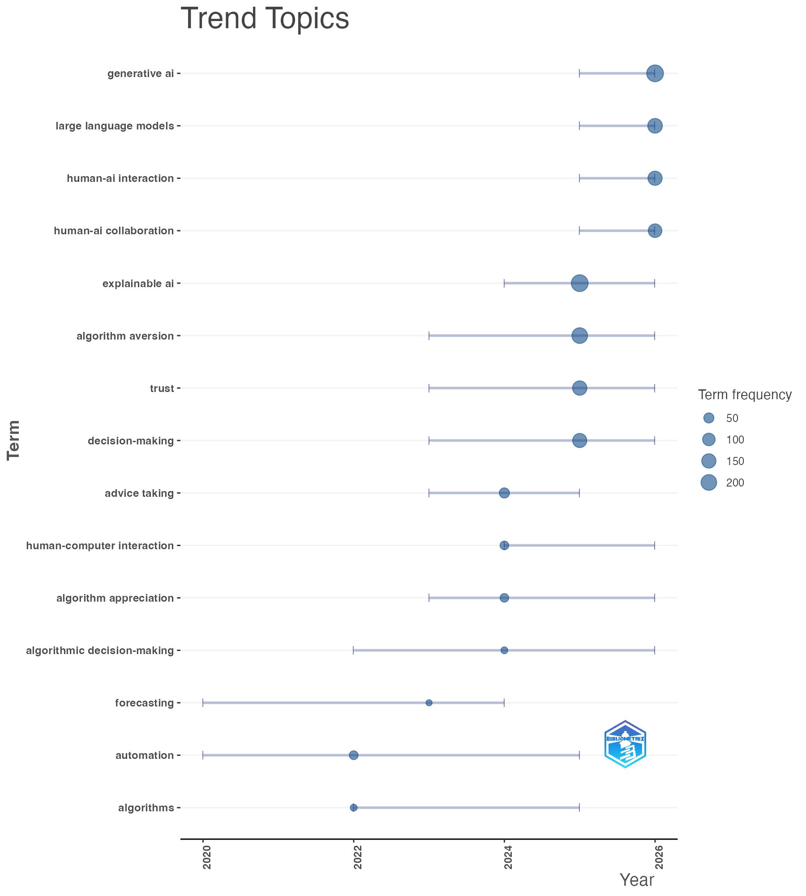
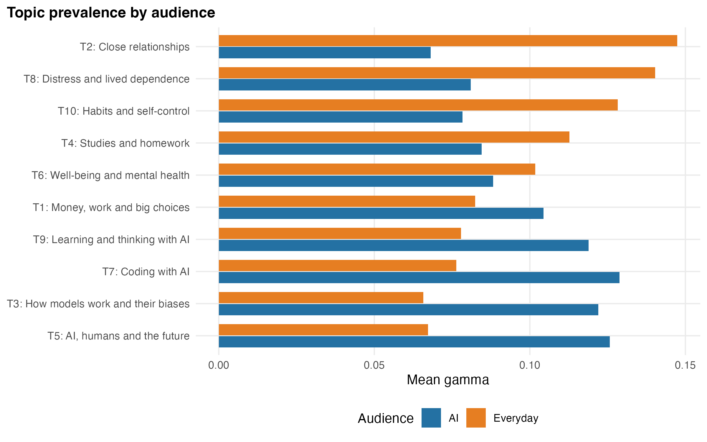
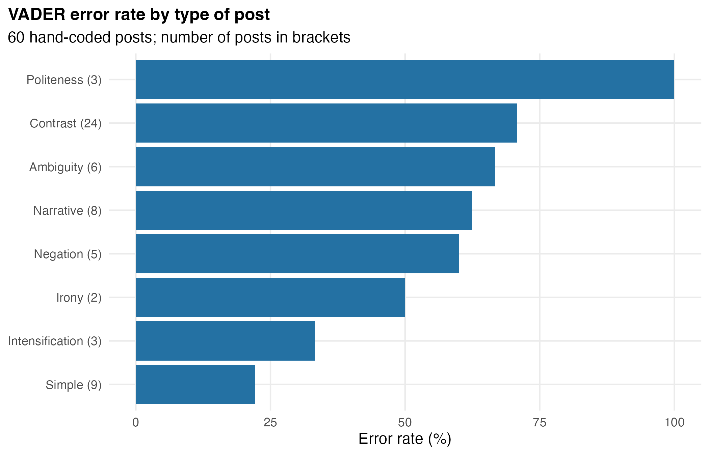

# Why do people rely on AI to decide?

Houda Es-sqalli · Computational Social Science (DAT602), taught by Prof. Aomar Ibourk · University Mohammed VI Polytechnic (UM6P), Rabat · October 2026

People sometimes follow AI too readily when they make a decision, and sometimes ignore it when it would have helped. This course project looks at the question from two sides: what researchers have studied (3,505 publications) and what people write about their own reliance on AI (633 Reddit posts). The repository holds the R code, the figures and the data that can be shared. Run on the original inputs, both pipelines reproduce every number below.

## Axis 1: what the research literature covers

- I built one search equation with three blocks (AI, relying on or delegating to it, decision). Each term was tested on its own and on random samples of titles before the final run ([`axis1_bibliometrics/search_equation/`](axis1_bibliometrics/search_equation/)).
- I queried three databases on the same day: Scopus (2,052 records), Web of Science (1,475) and OpenAlex (the 2,000 most relevant of 3,854). After merging and removing 2,022 duplicates, the corpus holds **3,505 publications**.
- I checked precision by hand on 60 random records: 40% core, 37% related, 23% off-topic. Most off-topic records came from OpenAlex, so the keyword analyses use only the author keywords from Scopus and Web of Science.
- Analyses in bibliometrix: thematic maps for three periods, keyword trends and a search for gaps.

**What I found.** The field took off in 2023 and its focus shifted. The keyword *generative AI* appeared in none of the publications from 2015-2022 but in 13.9% of those from 2025 onwards, while *algorithm aversion* fell from 16.5% to 6.4%. The literature says little about everyday decisions (3.1% of publications), field or long-term studies (3.8%) and African countries (3.6% of the publications that name a country, 15 of them on Morocco). Only 31 publications connect letting AI do the thinking (cognitive offloading) with following its advice to decide.

<p align="center"></p>

## Axis 2: what people say on Reddit

- I collected posts from January 2023 to October 2026 through Arctic Shift, a public archive of Reddit, in four AI subreddits (r/ChatGPT, r/OpenAI, r/ClaudeAI, r/ArtificialInteligence) and five everyday-life subreddits (r/DecidingToBeBetter, r/selfimprovement, r/productivity, r/college, r/Advice).
- Cleaning and a relevance filter took the corpus from 12,443 posts to **633**: posts whose author says they depend on AI or, in everyday subreddits, asks AI for advice. Each step is in [`selection_steps.csv`](axis2_reddit/data/selection_steps.csv). I checked precision by hand on 56 posts: 46% core, 43% related, 11% off-topic.
- Word frequencies and word clustering, then three topic models: LDA (K = 10, chosen on coherence and readability), a structural topic model (STM) with audience and year as covariates, and a biterm topic model (BTM), built for short texts, on the titles.
- Sentiment with VADER, which I **checked against my own hand coding** of 60 random posts.

**What I found.** AI subreddits discuss the tool and the tasks people hand over to it: code, how far its answers can be trusted, the future of AI. Everyday subreddits talk about the self, family, studies, therapy and habits. Over time, the posts move from debating what AI is worth to describing the room it now takes in daily life.

<p align="center"></p>

VADER rated most posts as positive, yet I coded 37 of the 60 as negative. It agreed with my coding on only 40% of posts (Cohen's kappa = 0.15), less than a naive rule that calls every post negative (62%). It was wrong on 17 of the 24 posts that mix positive and negative passages and on all 3 polite requests for help, against 2 of the 9 simple posts. A dictionary method like VADER should not be trusted on this kind of text without human validation.

<p align="center"></p>

## Repository

```
axis1_bibliometrics/
  scripts/            1_prepare_databases, 3_summarise_databases, 4_biblioshiny_file, 5_analyses
  search_equation/    0_test_search_equation, term tests, block tests, context tests,
                      precision sample (titles and judgments only)
  figures/            thematic maps (whole corpus and three periods), trend topics
axis2_reddit/
  scripts/            01_collect_reddit, 02_clean_and_filter, 02b_precision_check, 02c_lemmatise,
                      03_exploration, 04_topic_models, 05_vader_sentiment,
                      plot_style and word_lists (shared by the analysis scripts)
  data/               post IDs, selection steps, precision sample, hand coding (sentiment and post type)
  figures/            word frequencies, dendrograms, choice of K, LDA, STM, BTM, VADER validation
```

Run the scripts in numeric order, with the folder of each axis as the working directory (paths such as `corpus/` and `results/` are relative). Every model is seeded, so a rerun on the same inputs gives the same numbers.

## What is not included, and why

- **Scopus and Web of Science exports**: their licences do not allow redistribution. The search equations are documented, so the exports can be rebuilt.
- **Full text of the Reddit posts**: out of respect for the authors and Reddit's terms, only post IDs and metadata are shared. Usernames were used to remove bot posts and appear in no shared file. The corpus can be rebuilt from the IDs with Arctic Shift.
- **`merge_bases.R`**: Prof. Ibourk provided this merging script in class, and I used it unchanged except for the file paths. It is his code, so it is not republished here.

## Main R packages

bibliometrix, httr2 and jsonlite (collection), tidytext, tm, udpipe, topicmodels, ldatuning, textmineR, stm, BTM, vader, caret, tidyverse.

## Author

Houda Es-sqalli, Master's student in Behavioral and Social Sciences for Public Policy, UM6P · ORCID [0009-0005-5530-8154](https://orcid.org/0009-0005-5530-8154). Related work: [chatbot certainty in French and Arabic](https://github.com/HoudaEssqalli/chatbot-certainty-audit) ([preprint](https://doi.org/10.31235/osf.io/m2p5v_v1)) and [political interest, trust and turnout in the Arab world](https://github.com/HoudaEssqalli/institutional-trust-turnout-arab-barometer) ([preprint](https://doi.org/10.31235/osf.io/nwcju_v1)).
